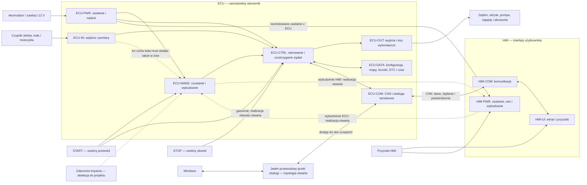

# Architektura blokowa DustONE

Stan na: 2026-11-04. **Materiał wstępny dla etapu 4, który oczekuje w kolejce**, wyprowadzona z [wymagań SYS-001–106](../01-zakres-systemu.md) i przyjętych ADR. Podział poniżej porządkuje projektowanie; nie wybiera komponentów, liczby pinów, protokołu PC ani topologii stopni mocy. G1 pozostaje otwarta.

Zakres silnikowy: jeden cylinder, 2T/4T i wyłącznie chłodzenie cieczą według SYS-098. Rozwinięcie projektu blokowego pozostaje w kolejce etapu 4.

## Granice systemu

Diagram pokazuje zależności funkcjonalne. Strzałki zasilania nie są kompletnym schematem szyn; wszystkie bloki wymagają właściwego zasilania. Droga standardowej obsługi obu urządzeń przez ECU-COM jest kandydatem do projektu. Miejsce złącza, interfejs PC i ewentualny mostek pozostają otwarte; SYS-027 nie przesądza USB w ECU. STOP działa bez HMI/CAN; rysunek nie ustanawia niezależności od procesora ECU, której realizacji jeszcze nie określono.

## Bloki i zadania

| ID bloku | Odpowiedzialność | Co musi być rozstrzygnięte przed doborem części |
| --- | --- | --- |
| ECU-PWR | Przyjęcie instalacji klasy 12 V, ochrona i dystrybucja energii, nadzór napięcia, kontrola zasilania HMI. | Zakresy napięć, rozruch i zakłócenia, prądy/temperatury, profile AGM/LiFePO4 i domeny zasilania. |
| ECU-WAKE | Obsługa źródeł wybudzania, koordynacja snu, blokady snu przy PC i wymaganych zadaniach. | Detekcja kopania, pierwszych impulsów koła, przycisków HMI i PC; pobór, opóźnienia, zasilanie HMI po awaryjnym odłączeniu części aktywnej. |
| ECU-IN | Synchronizacja, pomiary analogowe/cyfrowe (w tym MAP/CCPS według SYS-096/097), sensory na PCB oraz wejścia START, hamulców i pozostałych funkcji. | Modele osprzętu, zakresy, zasilanie, charakterystyki, dokładności, częstotliwości, zabezpieczenia i diagnostyka. |
| ECU-CTRL | Sterowanie czasowe silnikiem, reguły rozruchu/STOP/przewrócenia, automatyka akcesoriów i kontrola dopuszczenia poleceń. | Strategie i granice czasu, obciążenie obliczeniowe, reakcje na usterki i restart, warunki strojenia na żywo. |
| ECU-OUT | Jeden kanał zapłonu w trybie CDI lub TCI/IDI, wtrysk, pompa, power valve/IAC oraz wyjścia akcesoriów. | Rodzaje i liczby kanałów, jednoczesność, prądy/energia/czasy, granica stopni mocy i diagnostyka. SmartFET jest preferencją dla akcesoriów, nie wyborem konkretnego układu. |
| ECU-DATA | Właściciel konfiguracji i map, chronionych liczników, DTC/freeze frame, czasu rzeczywistego i ważności czasu. | Pojemność, trwałość i spójność zapisów, zakres utraty danych przy zaniku zasilania, reguły dostępu, odtwarzanie i obsługa pełnej pamięci. |
| ECU-COM | CAN ECU–HMI oraz logiczna obsługa konfiguracji, danych, diagnostyki, aktualizacji i development tool. | Interfejs PC, przepustowość, wersjonowanie, sesje/uprawnienia, formaty danych i odzyskiwanie. |
| HMI-PWR | Zasilanie z ECU, normalny sen na polecenie ECU i wybudzanie przyciskami. | Pobór i gotowość, działanie wybudzania także po awaryjnym odłączeniu części aktywnej, sterowanie ekranem. |
| HMI-UI | Ekran bez dotyku, odczyt przycisków, prezentacja danych i ostrzeżeń, układy użytkownika. | Ekran i obsługa, zasoby grafiki, czytelność, menu i pierwszeństwo ostrzeżeń. |
| HMI-COM | Żądania do ECU, odbiór rzeczywistych stanów, sekwencja snu i obsługa serwisowa HMI. | Protokół CAN, sygnalizacja aktywności użytkownika, aktualizacja i odzyskiwanie. |
| WIN-APP | Jedna aplikacja Windows: konfiguracja, strojenie, edytor HMI, diagnostyka, aktualizacja i narzędzia. | Przypadki użycia, uprawnienia, pliki/wersje, dopuszczenie operacji w stanach pojazdu, interfejs PC. |
| SYS-INST | PCB, obudowy, złącza, nowa wiązka i instalacja w motocyklu. | Miejsce montażu, gabaryty, prądy, ciepło, szczelność, pomiar barometryczny i dostęp serwisowy. |

ID są oznaczeniami architektury, bez przydziału konkretnych układów scalonych. ECU-CTRL i pozostałe bloki logiczne mogą korzystać ze wspólnych zasobów; ich fizyczny podział wybierzemy po bilansach.

## Zasady wynikające z przyjętych wymagań

- Dane niezbędne do działania silnika i jego zabezpieczeń trafiają do ECU. HMI i Windows wysyłają żądania; ECU rozstrzyga ich wykonanie (SYS-046/047).
- START i STOP pozostają niezależne od HMI/CAN. Ruch koła wybudza ECU do naliczania ODO i HMI do prezentacji; nie jest żądaniem rozruchu (SYS-037/048/079/080).
- Normalny sen pozostawia zasilanie HMI z ECU włączone. Awaryjne odłączenie części aktywnej nie może pozbawić przycisków funkcji wybudzania (SYS-064–066). Potrzebna jest analiza domen zasilania; nie wybrano jeszcze rozwiązania.
- Wspólna, jednakowo obsadzona PCB obsługuje uzgodnione warianty. [Macierz wariantów i zasobów](macierz-wariantow-silnika.md) jest podstawą przydziału I/O; jeden kanał zapłonu nie oznacza jednego wspólnego stopnia mocy CDI/TCI.
- Maksymalnie trzy niezależne, kompletne zestawy uzgodnionych map, ich przełączanie oraz strojenie na żywo mają odrębne reguły. [ADR-011](../decisions/adr-011-strojenie-na-zywo.md) zatwierdza strukturę zestawów i zmianę wybranych wartości podczas pracy. Utrata Windows zachowuje ostatnio zastosowane wartości w bieżącej pracy ECU (SYS-094), bez automatycznego utrwalania. Trwały zapis wymaga jawnego polecenia i zgaszonego silnika (SYS-095). Po restarcie ECU wybiera ostatnio wybrany prawidłowy zestaw spośród trwale zapisanych, bez zależności od HMI (SYS-099). Po prawidłowym śnie/wybudzeniu odrzuca niezapisane wartości i używa trwale zapisanych danych, bez automatycznego utrwalania (SYS-100). Robocza edycja dotyczy aktywnego i nieaktywnych zestawów i nie zmienia wyboru; nieaktywny zestaw wpływa na silnik dopiero po świadomym wybraniu (SYS-101). Krytyczną konfigurację ECU przyjmuje i wdraża tylko przy zgaszonym silniku, z blokadą rozrusznika, zapłonu i wtrysku przez całą operację (SYS-102). SYS-103 określa anulowanie nieukończonego transferu po utracie Windows przed wdrożeniem przy poprawnej dotychczasowej konfiguracji, ze zwolnieniem blokad i nową świadomą próbą rozruchu. SYS-104 wymaga samodzielnego dokończenia sprawdzania/wdrożenia po utracie Windows przy komplecie danych, przyjętym poleceniu i prawidłowym zasilaniu; blokady zwalniane po powodzeniu, a rozruch wymaga nowej świadomej próby. SYS-105 wymaga po błędzie automatycznego powrotu do poprzedniej konfiguracji po potwierdzeniu jej poprawności; brak poprawnych danych pozostawia blokady i dostęp serwisowy. SYS-106 wymaga po zaniku zasilania odtworzenia wyłącznie kompletnej poprawnej konfiguracji według trwałego potwierdzenia wdrożenia i samodzielnego dopuszczenia nowej świadomej próby bez Windows; bez poprawnych danych blokady i dostęp serwisowy pozostają. Listę map, walidację i warunki techniczne zapisu rozwijamy w [specyfikacji F02](../interfaces/mapy-i-konfiguracja.md).
- Chronione liczniki i polityka firmware obowiązują także przy diagnostyce, testach I/O, aktualizacji i odzyskiwaniu (SYS-074–078). Wymiana HMI nie tworzy nowego źródła liczników.
- Reakcje na CAN, światła, wentylator i niskie napięcie mają już częściowo uzgodnione reguły. Dokumentami źródłowymi pozostają [sen](usypianie-ecu-hmi.md), [oszczędzanie](oszczedzanie-energii.md) i rejestr SYS.

## Niewiadome do G1

| ID | Wynik potrzebny do dalszego projektowania | Prowadzenie / udział właściciela | Powiązanie |
| --- | --- | --- | --- |
| A01 | Modele i dokumentacja osprzętu reprezentującego sześć wariantów; wymagane pomiary, zakres obrotów i sygnały synchronizacji. | Asystent: analiza i propozycje; właściciel: potwierdzenie celów i dane dostępnej Bety. | F01, etapy 3–4. |
| A02 | Ocena konwersji i smarowania TPI dla konkretnego modelu. | Asystent: analiza, plan prób; właściciel: ustalenie dalszego zakresu po wynikach. | F01, SYS-033. |
| A03 | Macierz liczby/jednoczesności kanałów, parametry zapłonu, wtrysku, pompy, power valve i IAC. | Asystent: bilanse i propozycje; ważne kompromisy wspólnie. | F01/F04, etapy 3–6. |
| A04 | Domeny energii, prądy i czasy wybudzania, budżet 28 dni dla obu typów akumulatora, granice napięć. | Asystent: obliczenia i procedury; właściciel: pomiary i próby. | F03/F08, [budżet postoju](budzet-energii-postoju.md). |
| A05 | Interfejs PC, połączenia CAN, aktualizacja obu urządzeń i drogi odzyskiwania. | Asystent: porównanie architektur; wybór wspólny. | F06/F07, etapy 4–6. |
| A06 | Model danych, pamięć/czas, ochrona liczników i kalibracji drogi, reguły strojenia na żywo. | Asystent: wymagania zasobów i propozycja; decyzje produktowe/komponenty wspólnie. | F02/F07, etapy 4–6. |
| A07 | Gabaryty, montaż, bilans cieplny i współpraca pomiaru ciśnienia atmosferycznego ze szczelną obudową. | Właściciel: przestrzeń montażowa; asystent: rozwiązania i sprawdzenie. | F08, etapy 3/4/7. |

Przydział wymagań i grup weryfikacji: [macierz SYS → blok → weryfikacja](../verification/macierz-wymagan.md). Każda niewiadoma pozostaje otwarta do uzyskania danych i przeglądu; sam schemat blokowy nie dopuszcza PCB do wykonania.
