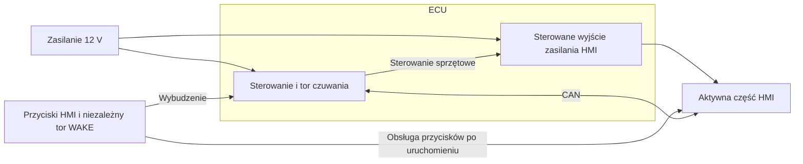

# Brak potwierdzenia uśpienia HMI — porównanie reakcji

Data: 2026-10-25. Status: właściciel po porównaniu w pytaniu 71 zatwierdził kontrolę zasilania HMI z ECU jako ścieżkę awaryjną; topologia i parametry do projektu. Podstawa: [normalna sekwencja ECU–HMI](usypianie-ecu-hmi.md), [ADR-003](../decisions/adr-003-wybudzanie-bez-wlacznika.md), SYS-054/055/057/062–065 w [zakresie systemu](../01-zakres-systemu.md).

## Porównanie

Poniższa ocena dotyczy sprawnego ECU i nieudanej komunikacji z HMI lub niesprawnej aplikacji HMI. Wymagania wybudzania przyciskami i blokady usypiania podczas pracy z komputerem nadal obowiązują.

| Podejście | Co zapewnia | Ograniczenie | Zakres dodatkowego projektu |
| --- | --- | --- | --- |
| Timeout i samodzielny sen ECU | Po ograniczonych ponowieniach ECU zapisuje problem i może zasnąć. | Stan HMI pozostaje niepotwierdzony; HMI może pozostać aktywne i pobierać energię. | Głównie obsługa protokołu, czasu i diagnostyki w firmware. |
| Reset HMI niezależny od CAN | Może odzyskać działanie po zawieszeniu programu, następnie można ponowić sekwencję. | Reset nie naprawia przerwanego CAN i nie potwierdza niskiego poboru całego HMI. Sam reset procesora nie odłącza zasilania pozostałych bloków. | Lokalny watchdog lub tor resetu z ECU; ograniczenie liczby prób i polityka dalszego postępowania. |
| Kontrola zasilania części aktywnej HMI | ECU może odłączyć ją mimo braku współpracy aplikacji HMI i CAN, przy sprawnym torze sprzętowym. | Trzeba zachować wybudzanie przyciskami, uwzględnić zimny start po odłączeniu i zweryfikować prąd pozostających torów czuwania. | Sterowany tor zasilania, sposób wybudzania, sygnały/wiązka i diagnostyka. |

Polecenie resetu wysyłane wyłącznie po CAN nie stanowi niezależnej drogi odzyskania przy uszkodzeniu komunikacji. Lokalny watchdog pomaga, jeśli jego nadzór wykrywa istotną usterkę aplikacji; poprawnie działający program oczekujący na przerwany CAN może nadal prawidłowo obsługiwać watchdog. To wniosek projektowy, nie wynik testów konkretnego HMI.

## Zachowanie wybudzania

Wariant z kontrolą zasilania musi zachować SYS-054/055: START, kopniak, PC i przyciski HMI mają nadal uruchamiać wymagane urządzenia. Dla przycisków potrzebna jest droga działająca przy wyłączonej części aktywnej HMI — np. osobna linia WAKE do ECU albo niezależnie zasilany tor czuwania zdolny zgłosić żądanie wybudzenia. Przyciski pozostają podłączone do HMI; osobny sygnał może przekazywać samo żądanie wybudzenia.

Zasilanie HMI wychodzi z ECU i jest przez nie kontrolowane (SYS-064). Przykład funkcjonalny z osobną linią WAKE poniżej; konkretny tor wybudzania pozostaje do wyboru:

Dobór topologii wymaga sprawdzenia działania przycisków przy wyłączonych napięciach, braku zasilania wstecznego przez sygnały, poboru czuwania oraz zachowania po przywróceniu zasilania. Samo pozostawienie zasilanego odbiornika CAN nie dowodzi jeszcze, że przycisk wybudzi również ECU przy odłączonej części aktywnej HMI.

## Podstawa techniczna

[TI TCAN1043A-Q1, Rev. F, rozdziały 3 i 7.4](https://www.ti.com/lit/ds/symlink/tcan1043a-q1.pdf) opisuje lokalne wybudzanie WAKE, odbiornik wybudzania CAN i wyjście INH sterujące zasilaniem węzła. To przykład możliwości rozdzielenia czuwania i części aktywnej. Wbudowany timer SWE działa w określonych stanach urządzenia; nie stanowi samodzielnego rozwiązania każdego braku odpowiedzi HMI.

[TI TPS3430-Q1, Rev. A](https://www.ti.com/lit/ds/symlink/tps3430-q1.pdf) opisuje niezależny watchdog okienkowy z wyjściem WDO. Skutek tego sygnału zależy od jego podłączenia i projektu systemu. Konkretnych układów do PCB nie wybrano; przywołania potwierdzają dostępność mechanizmów, bez deklaracji zgodności całego projektu z normami.

## Decyzja właściciela i kierunek realizacji

W odpowiedzi „71 — wybór po porównaniu” z 2026-10-25 właściciel zatwierdził **kontrolę zasilania HMI** i potwierdził jego wyprowadzenie z ECU. Zachowujemy wymagane wybudzanie przyciskami przy odłączonej części aktywnej. Zapis wymagań: SYS-064/065. Timeout ogranicza oczekiwanie; ewentualna próba odzyskania przez reset lub cykl zasilania wymaga jeszcze określenia.

Po nieudanej sekwencji z ograniczonym oczekiwaniem/próbami ECU odłącza część aktywną HMI, zapisuje problem i może zasnąć przy nadal spełnionych warunkach. Kontrolowany cykl zasilania może pełnić rolę resetu odzyskującego; osobną linię RESET rozważymy przy konkretnej potrzebie. Liczba prób i kryteria cyklu odzyskania pozostają do specyfikacji.

Awaryjne odłączenie należy odróżnić w diagnostyce od poprawnie zakończonej sekwencji z potwierdzeniem HMI. Nowa aktywność i zadania wymagające pracy mają pierwszeństwo. Blokady związane z komputerem, aktualizacją i zapisami pamięci muszą zapobiegać nieuprawnionemu odłączeniu energii w trakcie tych operacji.

Dokładny wpływ na PCB, złącza i BOM poznamy po wyborze topologii i bilansie mocy HMI. Mechanizm kontroli zasilania jest zatwierdzony; parametry, tor wybudzania i stan zasilania HMI po poprawnej sekwencji pozostają do określenia.

## Do weryfikacji po wyborze

Brak odpowiedzi aplikacji HMI, przerwana komunikacja, skuteczność i limit prób odzyskania, rzeczywiste odłączenie części aktywnej i jej pobór, ponowne wybudzenie ze wszystkich wymaganych źródeł oraz zachowanie podczas serwisu i aktualizacji. Ustalić parametry czasowe, zakres uwzględnionych uszkodzeń i sposób zwolnienia stanu awaryjnego. Testów sprzętu ani firmware nie wykonano.
