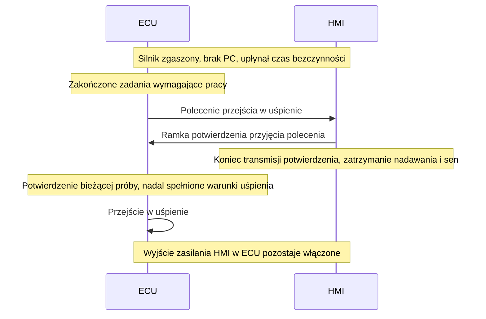

# Sekwencja usypiania ECU–HMI

Data: 2026-10-25. Status: uzgodniony normalny przebieg ze stale włączonym zasilaniem HMI podczas snu; kontrolowane odłączenie jako ostateczność przy awarii lub zdefiniowanych ograniczeniach. Topologia, szczegóły protokołu i czasy do projektu. Podstawa: odpowiedzi właściciela na pytania 70, „71 — wybór po porównaniu” i 72, [SYS-059/062–066](../01-zakres-systemu.md), [ADR-003](../decisions/adr-003-wybudzanie-bez-wlacznika.md).

## Uzgodniony przebieg

ECU jest koordynatorem. Przy zgaszonym silniku i odłączonym PC oczekuje na upływ konfigurowalnego czasu bezczynności i zakończenie wymaganych zadań, w tym obsługi wentylatora. HMI pozostaje aktywne do polecenia ECU.

Po poprawnej sekwencji oba urządzenia są w stanie niskiego poboru, przy nadal włączonym wyjściu zasilania HMI z ECU (SYS-066). To wybór właściciela w pytaniu 72; zwykłe usypianie nie zawiera odłączenia tego zasilania.

Potwierdzenie jest osobną aplikacyjną ramką CAN i oznacza przyjęcie polecenia do wykonania. HMI kończy jej wysłanie przed zatrzymaniem nadawania i przejściem w sen. Dokładna kolejność czasowa przejść obu urządzeń wymaga określenia i sprawdzenia na stanowisku. Rzeczywisty stan niskiego poboru potwierdzimy pomiarowo; ramka opisuje stan protokołu, a nie pomiar poboru prądu.

## Konsekwencje dla specyfikacji

- Próba rozruchu, użycie przycisków i rzeczywista praca użytkownika w HMI odnawiają czas bezczynności. Ustalić sygnalizację takiej aktywności do ECU. Sam cykliczny odczyt danych nie odnawia czasu.
- Powiązać potwierdzenie z bieżącą próbą usypiania. Spóźnione lub powtórzone potwierdzenie poprzedniej próby nie może samo uruchamiać snu ECU.
- Nowa aktywność, rozruch, praca silnika lub podłączenie PC mają pierwszeństwo przed kontynuowaniem usypiania. Sposób anulowania sekwencji i ponownego wybudzenia określić przed implementacją.
- Skoordynować wygaszanie okresowych transmisji ECU i HMI z wybranymi torami wybudzania, aby ruch końcowy nie powodował niezamierzonego ponownego wybudzenia. Zaplanowane zakończenie nadawania HMI odróżniać od nieoczekiwanej utraty komunikacji w diagnostyce.
- Blokada snu przy podłączonym PC pozostaje zgodna z SYS-057. Priorytet rozruchu i niezależność ECU od sprawności HMI pozostają zgodne z SYS-046/054.
- Tor sterowania zasilaniem HMI musi utrzymywać zadany stan podczas snu ECU: włączony po poprawnej sekwencji, odłączony po zadziałaniu ścieżki awaryjnej. Uwzględnić to przy wyborze stanów niskiego poboru, sterownika wyjścia i ewentualnego podtrzymania stanu.

## Wybrana ścieżka awaryjna

Właściciel zatwierdził sterowanie zasilaniem HMI z ECU. Przy braku potwierdzenia po ograniczonym oczekiwaniu/próbach ECU odłącza część aktywną HMI, rejestruje problem i może zasnąć, jeśli nadal spełnia warunki SYS-059. Ewentualny cykl odzyskania i jego parametry wymagają określenia. Stan awaryjnego odłączenia rozróżniamy od poprawnej sekwencji potwierdzonej przez HMI.

Wybudzanie przyciskami HMI oraz pozostałe źródła wybudzania muszą pozostać dostępne przy odłączonej części aktywnej HMI (SYS-064). Konkretny tor wymaga projektu. Nowa aktywność i blokady serwisowe mają pierwszeństwo przed kontynuowaniem odłączenia i snu.

## Otwarte decyzje i parametry

Formaty i identyfikatory ramek, oznaczenie bieżącej próby, czasy odpowiedzi i przejścia w sen, liczba ponowień, ewentualne odzyskiwanie HMI, topologia sterowanego zasilania oraz wybudzania i warunki ponownego załączenia. Ustalić rozstrzyganie nowej aktywności w każdej fazie, kryteria polityki ograniczeń HMI oraz stany wyjścia podczas resetu ECU.

[Porównanie timeoutu, resetu i kontroli zasilania](brak-potwierdzenia-uspienia-hmi.md) zachowuje uzasadnienie wyboru i rozważone alternatywy.

## Proponowana weryfikacja

Zarejestrować poprawny przebieg polecenia i potwierdzenia, zakończenie nadawania HMI oraz kolejność rzeczywistych przejść w stan niskiego poboru. Potwierdzić utrzymanie włączonego wyjścia zasilania HMI podczas snu ECU i zmierzyć pobór obu urządzeń. Sprawdzić odnawianie bezczynności po próbach START/kopniakiem i interakcji z HMI oraz blokady podczas pracy silnika, obsługi wentylatora, zapisów pamięci i połączenia z PC.

Wprowadzić nową aktywność w każdej fazie i sprawdzić, że nie kończy się ona nieuprawnionym uśpieniem. Sprawdzić spóźnione i powtórzone potwierdzenia, a przy braku potwierdzenia — ograniczenie oczekiwania, niezależne od CAN odłączenie części aktywnej HMI, zapis problemu i utrzymanie odłączenia podczas późniejszego snu ECU. Potwierdzić wymagane wybudzanie po odłączeniu oraz blokady podczas serwisu i zapisów pamięci. Kryteria czasowe i poboru ustalić przed próbami; testów sprzętu ani firmware nie wykonano.
