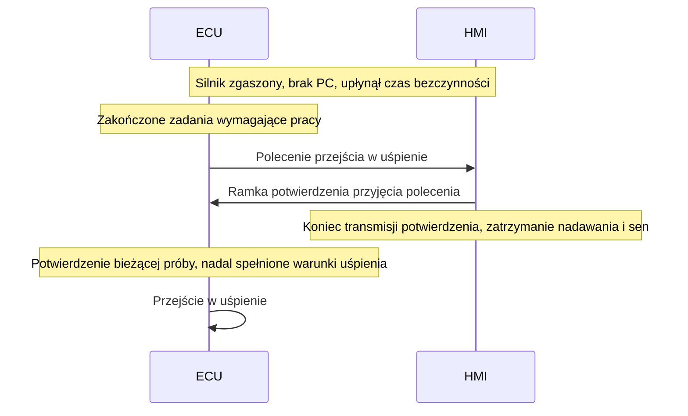

# Sekwencja usypiania ECU–HMI

Data: 2026-10-25. Status: uzgodniony normalny przebieg; szczegóły protokołu, czasy i wyjątki do projektu. Podstawa: odpowiedź właściciela na pytanie 70, [SYS-059/062/063](../01-zakres-systemu.md), [ADR-003](../decisions/adr-003-wybudzanie-bez-wlacznika.md).

## Uzgodniony przebieg

ECU jest koordynatorem. Przy zgaszonym silniku i odłączonym PC oczekuje na upływ konfigurowalnego czasu bezczynności i zakończenie wymaganych zadań, w tym obsługi wentylatora. HMI pozostaje aktywne do polecenia ECU.

Potwierdzenie jest osobną aplikacyjną ramką CAN i oznacza przyjęcie polecenia do wykonania. HMI kończy jej wysłanie przed zatrzymaniem nadawania i przejściem w sen. Dokładna kolejność czasowa przejść obu urządzeń wymaga określenia i sprawdzenia na stanowisku. Rzeczywisty stan niskiego poboru potwierdzimy pomiarowo; ramka opisuje stan protokołu, a nie pomiar poboru prądu.

## Konsekwencje dla specyfikacji

- Próba rozruchu, użycie przycisków i rzeczywista praca użytkownika w HMI odnawiają czas bezczynności. Ustalić sygnalizację takiej aktywności do ECU. Sam cykliczny odczyt danych nie odnawia czasu.
- Powiązać potwierdzenie z bieżącą próbą usypiania. Spóźnione lub powtórzone potwierdzenie poprzedniej próby nie może samo uruchamiać snu ECU.
- Nowa aktywność, rozruch, praca silnika lub podłączenie PC mają pierwszeństwo przed kontynuowaniem usypiania. Sposób anulowania sekwencji i ponownego wybudzenia określić przed implementacją.
- Skoordynować wygaszanie okresowych transmisji ECU i HMI z wybranymi torami wybudzania, aby ruch końcowy nie powodował niezamierzonego ponownego wybudzenia. Zaplanowane zakończenie nadawania HMI odróżniać od nieoczekiwanej utraty komunikacji w diagnostyce.
- Blokada snu przy podłączonym PC pozostaje zgodna z SYS-057. Priorytet rozruchu i niezależność ECU od sprawności HMI pozostają zgodne z SYS-046/054.

## Otwarte decyzje i parametry

Formaty i identyfikatory ramek, oznaczenie bieżącej próby, czasy odpowiedzi i przejścia w sen, ponowienia oraz reakcja na brak potwierdzenia lub brak HMI. Ustalić warunki rozstrzygania nowej aktywności podczas polecenia, transmisji potwierdzenia i końcowego przejścia w sen. Nie wybrano jeszcze zachowania awaryjnego po braku potwierdzenia.

## Proponowana weryfikacja

Zarejestrować poprawny przebieg polecenia i potwierdzenia, zakończenie nadawania HMI oraz kolejność rzeczywistych przejść w stan niskiego poboru. Sprawdzić odnawianie bezczynności po próbach START/kopniakiem i interakcji z HMI oraz blokady podczas pracy silnika, obsługi wentylatora, zapisów pamięci i połączenia z PC.

Wprowadzić nową aktywność w każdej fazie i sprawdzić, że nie kończy się ona nieuprawnionym uśpieniem. Sprawdzić spóźnione, powtórzone i brakujące potwierdzenie według później przyjętej polityki. Kryteria czasowe i poboru ustalić przed próbami; testów sprzętu ani firmware nie wykonano.
